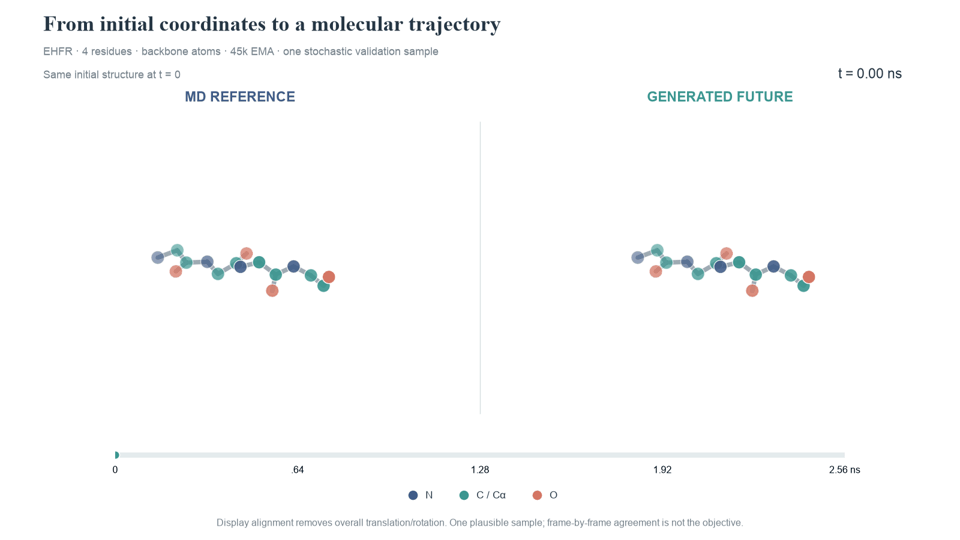
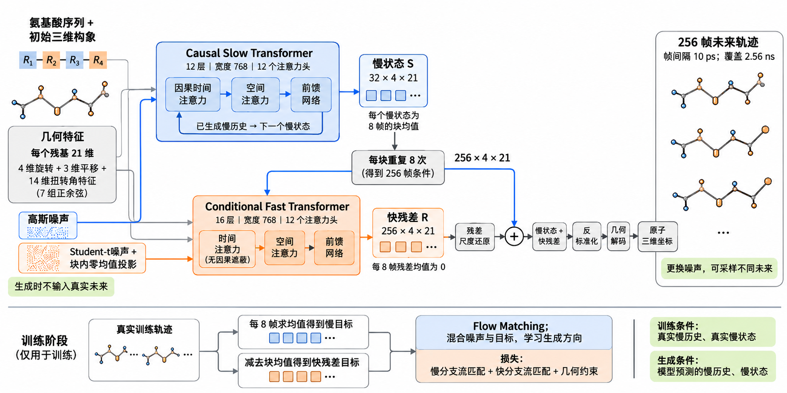
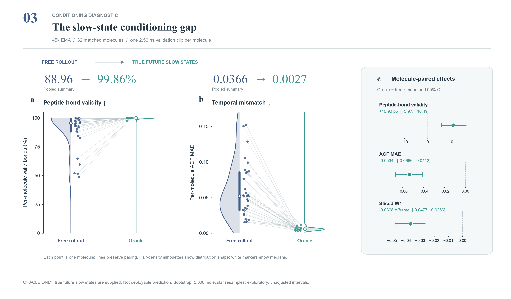
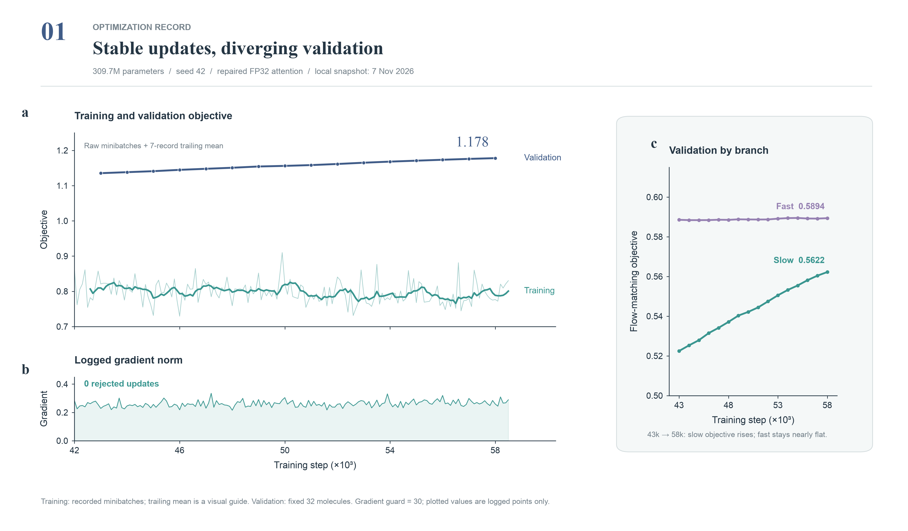

# MolMotion｜四肽分子轨迹生成与评估

**把分子的运动拆成缓慢变化的整体状态与快速波动，研究如何生成合理轨迹，并为后续物理模拟提供候选起点。**

本项目基于 MDGen 的四肽数据与几何表示开展研究，包含慢快双分支 Transformer、单尺度对照、轨迹评价及构象探索应用实验。当前版本 **`0.1.0`** 提供四肽 PDB 输入、预训练权重加载、轨迹生成、评价和 PDB/XTC 导出。模型是研究级模型，质量边界见下方实验结果及 [模型卡](MODEL_CARD.md)。

[快速安装](#快速安装) · [如何调用](#如何调用) · [模型架构](#模型架构) · [实验结论](#实验结论) · [代码目录](#代码目录) · [发布路线](docs/PUBLISH_ZH.md)

## 我们想解决什么问题

同一个分子可以呈现多种三维构象。物理分子动力学模拟逐步计算原子的运动，短时间模拟往往只探索起点附近的一部分构象。我们研究两个问题：

1. 模型能否从氨基酸序列和初始结构出发，生成结构合理、运动统计接近真实模拟的未来轨迹？
2. 从生成轨迹中筛选合理构象作为模拟起点，在相同仿真步数下，能否探索更多构象？

适用范围是当前数据中的**四肽体系**。没有验证任意长度蛋白质、药物结合预测或实验动力学精度。

## 看看实际生成的轨迹



图中是 45k EMA 检查点、固定验证集中的第一条 EHFR 示例，展示 16 个主链原子。原始时间间隔为 10 ps，未来 256 帧覆盖 2.56 ns。显示时做了刚体对齐以便观察；这不是模型额外预测的一步。随机生成轨迹不要求和参考轨迹逐帧重合，质量判断依赖下面的统计评价，不能只看视频。

## 模型架构



| 环节 | 实现与含义 |
|---|---|
| 输入 | 四肽氨基酸序列、初始三维构象及随机噪声 |
| 几何表示 | 每个残基 21 维：4 维旋转、3 维平移、7 组扭转角正余弦 |
| 慢分支 | 12 层、宽度 768、12 个注意力头的因果 Transformer；预测 32 个慢状态 |
| 快分支 | 16 层、宽度 768、12 个注意力头的条件 Transformer；生成 256 帧快残差 |
| 分解方式 | 每 8 帧求均值得到慢状态；快残差在块内均值为零 |
| 训练 | Flow Matching 与几何约束；原方案使用真实慢历史及真实慢条件 |
| 推理 | 使用模型生成的慢历史与慢状态；不输入真实未来 |
| 输出 | 特征恢复尺度、反标准化、几何解码后得到原子坐标 |
| 单尺度 baseline | 同宽度的 28 层 Transformer，直接联合生成轨迹；参数量接近但计算量不完全相同 |

示意图对应原始主方案；低学习率、慢分支 dropout、几何损失分支解耦属于另行实验的修复版本。代码中的低层 `generate()` 返回**归一化几何特征**，不是已经解码的原子坐标。

## 快速安装

推荐 Python 3.12；当前元数据要求 Python ≥3.10。已在 Python 3.12 的 CPU 环境测试安装与接口，完整 CUDA 训练依赖需另行配置。

```bash
git clone https://github.com/Leo-di/MolMotion.git
cd MolMotion
python -m venv .venv
# macOS / Linux
source .venv/bin/activate
# Windows PowerShell 改用：.venv\Scripts\Activate.ps1
python -m pip install --upgrade pip
python -m pip install .
python examples/check_install.py
molmotion --help
```

需要导入神经网络模型时，额外安装 PyTorch：

```bash
python -m pip install '.[model]'
python -m unittest discover -s tests -v
```

也可以直接从 GitHub 安装：

```bash
python -m pip install 'molmotion-research @ git+https://github.com/Leo-di/MolMotion.git'
```

`examples/check_install.py` 使用合成数组检查接口，不代表已训练模型效果。正式发布完成后可用 `python -m pip install "molmotion-research[model]==0.1.0"`。GitHub 源码安装和 PyPI 安装提供相同的公共接口；模型权重在首次调用时单独下载。

## 如何调用

### 1. 评价已有坐标轨迹：已经可以调用

```python
from molmotion import evaluate_npz

result = evaluate_npz("trajectory.npz")
print("键长有效率：", result["bond_valid"])
print("速度分布 W1：", result["velocity_sliced_w1"])
print("扭转角 ACF 误差：", result["acf_mae"])
```

命令行等价用法：

```bash
molmotion evaluate trajectory.npz --output metrics.json
```

输入是包含以下成员的 NPZ，必须采用 MDGen atom14 的原子顺序：

| 字段 | 形状 | 说明 |
|---|---|---|
| `generated` | `[B,T,4,14,3]` | 生成的原子坐标，单位 Å |
| `reference` | `[B,T,4,14,3]` | 参考坐标，与生成数据有相同形状和帧间隔 |
| `sequence_ids` | `[B,4]` | 残基编码，沿用 MDGen 定义 |
| `atom_mask` | `[B,4,14]` | 实际存在原子的 0/1 掩码；须包含 N、CA、C、O |

至少需要 3 帧。比较多个方法时，统一样本、帧数、是否包括初始帧及时间间隔。当前函数计算输入全部帧的 **pooled 指标**，不会自动做逐分子配对检验或置信区间估计。精简的 `*.plot.npz` 不含完整坐标，不能直接传入这个接口。

| 指标 | 如何理解 |
|---|---|
| `bond_valid` ↑ | 残基间 C—N 键长在 1.1–1.6 Å 内的比例；不是全部化学有效性的证明 |
| `velocity_sliced_w1` ↓ | 主链逐帧位移分布的 sliced W1；当前单位为 Å/帧，未除以时间间隔 |
| `acf_mae` ↓ | 扭转角时间自相关曲线误差，反映运动的时间关联 |
| `nonadjacent_clash_frame_fraction` ↓ | 指定非相邻残基间存在过近原子的帧比例 |
| `motion_ratio` | 生成与参考的逐帧位移幅度比；需结合其他指标解释 |

### 2. 输入四肽 PDB，生成未来轨迹

安装 `.[model]` 后运行（CPU 可用于验证，GPU 建议用于采样）：

```python
from molmotion import MolMotionPipeline

pipeline = MolMotionPipeline.from_pretrained("tetrapeptide-v0.1.0", device="cpu")
trajectory = pipeline.generate("examples/IMCP.pdb", num_frames=256, num_samples=1, seed=42)
trajectory.save_npz("output/trajectories.npz")
trajectory.save_pdb("output/trajectory.pdb")
trajectory.save_xtc("output/trajectory.xtc")
print("键长有效率：", trajectory.bond_validity())
```

命令行：

```bash
molmotion generate examples/IMCP.pdb --device cpu --output-dir output/demo
# 有 NVIDIA GPU 时可指定 --device cuda
```

首用下载约 1.24 GB 权重，默认缓存到 `~/.cache/molmotion/`。也可从 [v0.1.0 Release](https://github.com/Leo-di/MolMotion/releases/tag/v0.1.0) 下载 `config.json` 与 `model.safetensors` 到同一目录，将该目录传给 `from_pretrained`。加载会校验 SHA256、特征版本和归一化参数，不加载 pickle 检查点。

输入必须是单链四肽，包含标准残基的全部重原子，且分子没有被周期性边界切断；本版本不处理封端、缺失侧链、配体或修饰残基。返回数组 `trajectory.coordinates` 为 `[样本数,257,4,14,3]`，单位 Å。第 0 帧保留输入坐标；后续 256 帧由模型生成并经几何解码。XTC 自动转换成 nm，帧时间单位 ps。XTC 有压缩量化误差，精确分析优先使用 NPZ。

给定同形状参考坐标，可调用 `trajectory.evaluate(reference_coordinates)`。生成 NPZ 本身不包含真实未来，因此不能直接传给要求 `reference` 字段的 `evaluate_npz`。

### 3. 筛选后续模拟的候选起点

```python
candidates = trajectory.propose_seeds(count=3)
for candidate in candidates:
    print(candidate["sample"], candidate["frame"], candidate["time_ps"])
    # candidate["coordinates"] 为 [4,14,3]，单位 Å
```

先过滤不合理肽键与明显原子碰撞，再按扭转角差异贪心选择候选；样本不足会报错。这是构象候选筛选，不等于已通过能量或物理稳定性验证。完整 OpenMM 应用实验在 `research/applications/`，尚未封装成自动模拟服务。

## 实验结论

以下是 **2026-11-08 上午结果快照**，不表示之后仍在运行的实验已经结束。

### 与单尺度 baseline 的固定预算比较

同一训练种子 43、固定 65k 步、32 个验证分子的评估：

| 方法 | 键长有效率 ↑ | pooled 速度 W1 ↓ | pooled ACF MAE ↓ |
|---|---:|---:|---:|
| 慢快模型（我们） | 87.34% | 0.02320 | 0.02408 |
| 单尺度 baseline | **95.29%** | 0.02443 | 0.02560 |

单尺度模型在键长有效率上领先约 **7.96 个百分点**。慢快模型的 pooled 动态指标较低；逐分子的 W1 配对差区间跨零，尚不能认定在各分子上稳定改善。详见 [`fixed-budget-summary.json`](results/fixed-budget-summary.json) 和 [证据状态](docs/STATUS.md)。这组对照没有证明慢快模型整体优于 baseline。

### 为什么排查慢状态



该图对应 **45k、32 分子的诊断实验**。将自由滚动的慢状态替换为真实未来慢状态后，键长和动态统计明显改善，说明慢状态条件质量值得重点排查。**Oracle 使用真实未来信息，不能部署，也不能当作我们方法战胜 baseline 的结果。** 图中的 pooled 汇总与逐分子配对区间是两种聚合口径。

### 训练过程记录



这张历史图展示修复后同一次主训练的损失、验证分量及梯度记录；训练线包含尾随均值，验证线不平滑。它不是最新 100k 实验的收敛结论，也不能用损失下降代替生成质量评价。

### 实际应用：帮助选择物理模拟起点

32 个四肽、两组各 3 条 50 ps 模拟，在扣除起始构象所属分箱后，60° 构象分箱统计得到：

- 模型起点组比原始起点组平均多探索 **2.6875 个新分箱**，配对区间为 **[1.09375, 4.1875]**。
- **24/32** 个分子改善。
- 这是**等仿真步数**下的结果。将 CPU 模型生成耗时计入总预算后，该短预算实验没有显示端到端时间收益。

因此，目前应用价值是“提出值得进一步物理验证的起点”；还不能宣称替代物理模拟或整体加速。

## 数据来源与代码基础

- 数据：[MDGen tetrapeptide-sims](https://huggingface.co/datasets/bjing-mit/tetrapeptide-sims)。主训练协议记录 256 个训练分子、32 个验证分子；验证集上的结论不等于独立测试集结论。
- 基础工作：[MDGen — Generative Modeling of Molecular Dynamics Trajectories](https://github.com/bjing2016/mdgen)。本项目使用其几何表示、解码工具和条件生成任务设置。
- 研究变量：慢快分解、因果慢状态滚动、条件快残差与相关训练修复。
- 参数量接近不代表 FLOPs、采样器评估次数、显存或耗时完全匹配。具体比较应以协议和日志为准。

## 代码目录

```text
src/molmotion/          推理流水线、轨迹导出、模型、指标与 CLI
examples/              安装检查与 MIT 许可的 IMCP 初始 PDB
tests/                 模型与指标契约测试
research/runtime/      原主模型及单尺度训练、几何处理、生成评估
research/repair-runtime/ 慢分支修复版本
research/audits/        固定预算、收敛、修复与梯度诊断脚本
research/mdgen-baseline/ MDGen baseline 训练评估实现
research/applications/ 原起点选择、复核及等总耗时模拟实验
configs/               主训练协议
results/               历史结果、最新数值长表、作图文件索引
docs/assets/           架构图、真实轨迹动图和结果图
```

研究脚本仍包含原实验的目录约定和配置要求，**不等于安装后可以直接一键复现全部实验**。见 [研究代码说明](research/README.md)。特定服务器的登录、自动排队和同步脚本没有作为公共 API 上传；权重、原始轨迹与训练缓存单独管理。

## 作图数据与结果索引

- [`experiment-index.csv`](results/experiment-index.csv)：历史实验／证据索引；行数不是独立实验数。
- [`20261108-numeric-results-long.csv`](results/20261108-numeric-results-long.csv)：最新数值长表，包含配置数字，需按字段筛选。
- [`20261108-plot-file-catalog.csv`](results/20261108-plot-file-catalog.csv)：3,388 份本地作图材料的相对路径、校验和与数组保留情况。
- [`application-equal-steps-per-molecule.csv`](results/application-equal-steps-per-molecule.csv)：应用对照的逐分子结果。

文件索引不是文件下载地址。精简作图数组目前保存在项目本地归档，没有全部上传 GitHub。复核必须区分不同检查点、预测长度、样本数、随机种子及预算。

## 发布与复现

- [GitHub Release v0.1.0](https://github.com/Leo-di/MolMotion/releases/tag/v0.1.0)：代码包、推理权重、配置与模型卡。
- [PyPI 项目](https://pypi.org/project/molmotion-research/)：轻量代码分发，权重独立下载。
- [中文维护者发布指南](docs/PUBLISH_ZH.md)：Trusted Publishing 配置与发布检查。
- [模型卡](MODEL_CARD.md)：训练来源、权重选择、适用范围与局限。
- 工程验证记录：`docs/release-validation.json`；单元与接口测试：`python -m unittest discover -s tests -v`。

## 许可与引用

MolMotion 原创代码和自训练模型按 Apache-2.0 发布；内置 MDGen 几何文件及样例数据按原始 MIT/Apache-2.0 许可保留声明。见 [LICENSE](LICENSE)、[NOTICE](NOTICE) 和 [第三方说明](THIRD_PARTY_NOTICES.md)。

引用本仓库时请注明版本／commit、实验配置与数据来源，并引用 MDGen 原工作。项目尚无单独论文或 DOI。
